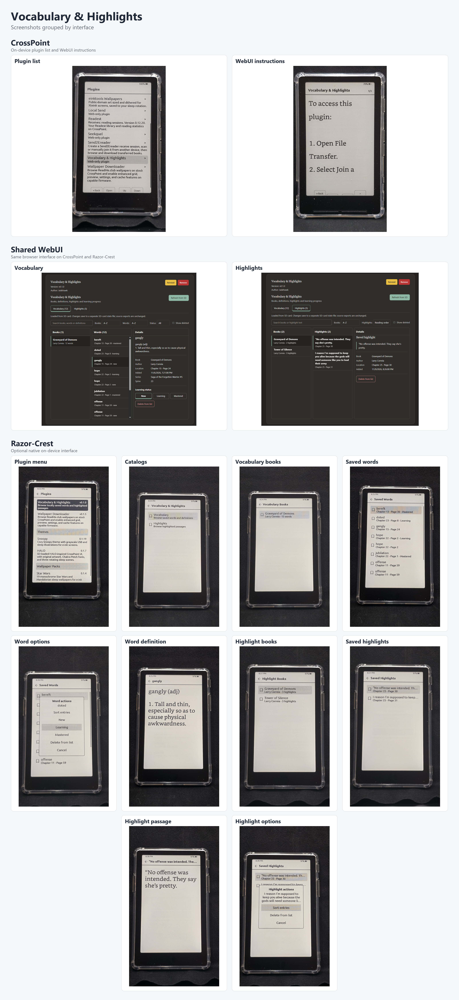

# Vocabulary & Highlights - CrossPoint plugin

An SD-card plugin for reviewing saved words and highlighted passages on readers implementing the CrossPoint plugin API. Its browser WebUI works with compatible firmware. Offline, on-device browsing and editing are optional enhancements when the host firmware implements `ui.local-notes.v1`.

**Release status:** Version **0.1.0**, first public release not yet published. No Internet service, account, or API key is required for normal use.

## Screenshots

Screenshots are grouped by interface: CrossPoint's on-device plugin screens, the shared browser WebUI, and the optional native viewer currently available on Razor-Crest.



Full-resolution originals: [CrossPoint](docs/screenshots/originals/crosspoint/) | [Shared WebUI](docs/screenshots/originals/webui/) | [Razor-Crest](docs/screenshots/originals/razor-crest/).

## Plugin Hub repository layout

This repository follows the [official Plugin Hub publishing contract](https://github.com/crosspoint-reader/crosspoint-plugin-hub/blob/main/PLUGIN_HUB_CONTRACT.md):

```text
vocabulary-highlights.crosspoint-plugin/
  manifest.json
  device.json
  plugin.js
  style.css
  README.md
  DETAILS.md
tests/                         # development-only
tools/                         # development/packaging
docs/                          # development/release notes
README.md
CHANGELOG.md
package.json
```

The repository's installable payload folder must be `vocabulary-highlights.crosspoint-plugin/` to satisfy automatic Plugin Hub discovery. Once installed, the folder is **`/.crosspoint/plugins/vocabulary-highlights/`**. **Do not rename the on-device folder** to include the `.crosspoint-plugin` suffix.

Plugin Hub installs only the runtime files declared in `manifest.json`, pinned to an immutable matching stable GitHub Release tag. Root-level tests, packaging scripts and developer documentation are not installed. A Release ZIP is not required for the normal standalone-repository discovery path; our optional ZIP supports manual sideloading.

## Manual installation

Copy the **contents** of `vocabulary-highlights.crosspoint-plugin/` into one of the firmware's supported roots:

- `/.crosspoint/plugins/vocabulary-highlights/` (recommended)
- `/plugins/vocabulary-highlights/`
- `/.plugins/vocabulary-highlights/`

Alternatively, extract `dist/vocabulary-highlights-0.1.0.zip` into your preferred plugin root; its archive contains a `vocabulary-highlights/` folder.

Enable **Settings → Connectivity → Plugins**. Run File Transfer/WebUI mode and open **Plugins → Vocabulary & Highlights** in a browser. Without the optional native interface, the on-device plugin entry displays the included README: browser JavaScript does not run on the e-ink display. When `ui.local-notes.v1` is implemented by the host firmware, the device can instead open an offline viewer with optional Home shortcut.

## Features

| Browser WebUI (standard plugin API) | Optional native reader UI (`ui.local-notes.v1`) |
| --- | --- |
| Vocabulary and Highlights, grouped by book and author | Browse both exports offline, by book |
| Search, sort, pagination, full definitions and passages | Sort book/entry lists, open saved details |
| New / Learning / Mastered vocabulary statuses | Same vocabulary learning statuses |
| Hide and restore words and highlights | Hide and restore words and highlights |
| Hide books with zero visible records by default | Keep books visible for recovery even if all records are hidden |

**Native book counts include hidden entries.** A book with one hidden highlight still shows **1 highlight**, even if its visible entry list is empty. Use **Show deleted → Restore entry** on the device. In the WebUI, the book disappears until **Show hidden** is selected. This intentionally preserves the native restoration path.

Native browsing is provided by capable host firmware, not by executing browser JavaScript on the reader. The plugin manifest intentionally does not require the optional native capability, so browser functionality remains available on compatible firmware without it.

## Source exports and saved state

The plugin reads the firmware's SD-root exports without rewriting them:

| File | Content |
| --- | --- |
| `/Vocabulary.txt` | v1 JSON Lines: word IDs, definitions, and book/location data |
| `/My Clippings.txt` | Kindle-style highlighting records, including page and optional chapter/date |

Hide/delete actions change only versioned state at `/.crosspoint/vocabulary-highlights/state-v1.json`. If the new state does not exist, the earlier `/.crosspoint/vocabulary-builder/state-v1.json` can be migrated after the first edit; the old state is kept as a backup. Do not remove the old **state** directory when removing an obsolete Vocabulary Builder *plugin installation*.

WebUI state files can reach approximately **240 KiB**. The bounded native reader permits **8 KiB on no-PSRAM X3** and **24 KiB on other boards**; invalid or oversized state disables native editing instead of erasing progress. Large valid state remains editable via the WebUI.

## Native limits and validation

The native UI currently indexes at most **64 books / 192 selected-book entries** on X3, or **128 books / 512 entries** on other targets. Each scanned record has a 6 KiB cap, and incomplete appended records are ignored. These are deliberate RAM limits, not unlimited indexing.

Native browsing and editing passed device testing, including on an X3 without PSRAM. Hiding and restoring a book's only highlight was confirmed to synchronize with WebUI visibility. **Further testing is needed** for identical duplicate highlights, oversized saved state, and large libraries before claiming broad device coverage.

## Development

The plugin itself requires no firmware build. Run automated tests with Node.js 20+:

```sh
npm run check
```

Optionally build a manual-install ZIP with Python 3 (standard library):

```sh
python tools/package_plugin.py
```

For tests against real exports, set `VOCAB_SAMPLES_DIR` to the local folder containing `Vocabulary.txt`, `Vocabulary (5).txt`, and `My Clippings.txt`. Never commit personal reading-history exports.
